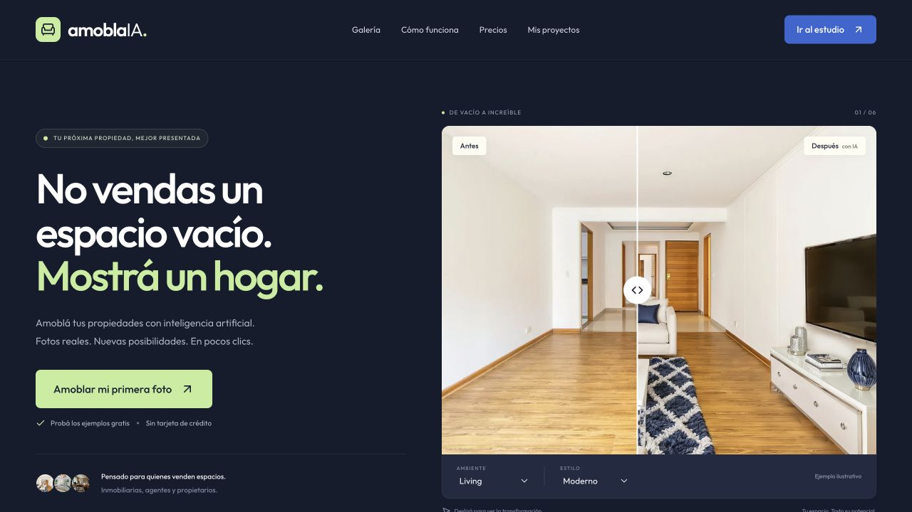

# amoblaIA

Virtual staging para Latinoamérica. MVP en español inspirado en la experiencia pública de [Virtual Staging AI](https://www.virtualstagingai.app/), con implementación propia en Next.js y motor configurable de edición de imágenes.



## Qué funciona

- Landing responsive, galería filtrable, FAQ, página de acceso/precios y estudio.
- Carga por archivo o arrastrar y soltar: JPG, PNG y WebP hasta 10 MB. Optimización en el navegador antes de enviar y validación real de los bytes en el servidor.
- Ocho ambientes, diez estilos, amoblamiento, rediseño y retiro de muebles.
- Edición de fotos propias mediante OpenAI Images API, con calidad alta y restricciones de conservación arquitectónica.
- Comparador antes/después accesible con teclado, descarga JPG y exportación de ambas imágenes lado a lado.
- Etiqueta opcional de amoblamiento virtual en las exportaciones.
- Historial de los últimos 20 proyectos en IndexedDB, con recuperación y borrado individual.
- Demo con fotos precargadas, sin API, registro ni tarjeta. Está identificada como demo y no simula generación sobre fotos propias.
- Acceso privado de piloto: contraseña compartida, cookie HttpOnly firmada y vencimiento a las 8 horas.

**Modos:** el piloto sigue funcionando con contraseña compartida mientras `SAAS_ENABLED=false`. La nueva capa comercial incluye cuentas Supabase, fotos privadas, variantes agrupadas, créditos transaccionales, catálogo, integración Mercado Pago, panel de administración y generación tras la respuesta. Los cobros y las altas públicas permanecen desactivados hasta configurar y verificar sus proveedores. Consultá [docs/COMMERCE_SETUP.md](docs/COMMERCE_SETUP.md) para el alcance, instalación, limitaciones y requisitos de lanzamiento.

## Deploy en Vercel

1. Importá **axellaban/amoblaia** como nuevo proyecto. La aplicación está en la raíz del repositorio.
2. Framework: **Next.js**. Node.js: **24.x**. Conservá los comandos de instalación y build automáticos.
3. Para explorar la demo, podés desplegar sin variables.
4. Para generar con fotos propias, configurá estas variables en **Settings → Environment Variables**:

| Variable                  | Valor                                                                                                                                             |
| ------------------------- | ------------------------------------------------------------------------------------------------------------------------------------------------- |
| `OPENAI_API_KEY`          | Una clave de tu cuenta de OpenAI con facturación habilitada y acceso al modelo de imágenes. Nunca uses un prefijo `NEXT_PUBLIC_` para esta clave. |
| `OPENAI_IMAGE_MODEL`      | `gpt-image-2.5-sunburst` (también es el valor predeterminado si se omite).                                                                        |
| `STUDIO_ACCESS_PASSWORD`  | Una contraseña aleatoria de al menos 16 caracteres para compartir con los participantes del piloto.                                               |
| `NEXT_PUBLIC_CONTACT_URL` | Opcional: enlace HTTPS comercial, por ejemplo a tu formulario de contacto o WhatsApp.                                                             |

5. Confirmá que **Fluid compute** esté habilitado. La ruta de generación declara `maxDuration = 300`, con timeout del proveedor a los 270 segundos. Los archivos se optimizan para quedar debajo del límite de 4.5 MB de Vercel Functions.
6. Desplegá o hacé **Redeploy** después de agregar o cambiar variables. Las variables privadas se leen en el servidor; el enlace público de contacto se incorpora al build.
7. Abrí `/estudio`, subí una foto, ingresá la contraseña del piloto, aceptá el envío al proveedor y generá un diseño. La primera verificación con una API real debe hacerse con una foto de prueba autorizada.

La API de imágenes tiene costo y puede requerir verificación de la organización. El costo se factura en la cuenta configurada, no en ChatGPT. La contraseña del piloto protege el endpoint; el modo piloto no tiene cupos individuales. La capa comercial agrega autenticación individual, saldo persistente, una generación simultánea por cuenta y límite diario global. Habilitá las cuentas solo después de configurar el proveedor de acceso y comprobar el presupuesto de consumo.

Referencias oficiales: [Images API](https://developers.openai.com/api/docs/guides/image-generation), [Sunburst](https://developers.openai.com/api/docs/models/gpt-image-2.5-sunburst), [límites de Vercel](https://vercel.com/docs/functions/limitations).

## Desarrollo local

```bash
nvm use
npm ci
cp .env.example .env.local
npm run dev
```

Abrí http://localhost:3000. Podés dejar las variables vacías para usar la demo. No subas `.env.local` a GitHub.

```bash
npm run lint
npm run typecheck
npm test
npm run build
npm start
```

Los tests cubren firmas de sesión, vencimiento, origen, validación de opciones y fotos, y el pipeline de generación con un proveedor simulado. No gastan API ni demuestran por sí solos la calidad visual del modelo real.

## Motor de IA y calidad

Se eligió **GPT Image 2.5 Sunburst en calidad alta** el 20/10/2026 por el énfasis de su documentación oficial en edición precisa. Se revisó también Nano Banana 2.1. La elección es una hipótesis de producto fundamentada, no un benchmark universal: validá con tus fotos antes de prometer resultados o tiempos de entrega. Podés cambiar el modelo de OpenAI con una variable. Cambiar a otro proveedor requiere adaptar la ruta `src/app/api/generate/route.ts`.

La foto se envía como entrada de edición, con instrucciones explícitas de conservar cámara, paredes, aberturas, pisos, cielorrasos, instalaciones y luz. Los resultados generativos deben revisarse con el comparador antes de publicarlos. No hay detección automática que garantice la conservación de estructura.

En modo piloto, la generación es síncrona: dejá la pestaña abierta. En modo comercial, el trabajo y su resultado se guardan en Supabase y el navegador consulta el estado. La ejecución en segundo plano sigue limitada por la duración de la función; los resultados inciertos requieren conciliación y no se reenvían automáticamente. Ver las limitaciones en la guía comercial.

## REA y referencias visuales

Se ejecutó **rea-agents 6.7.0** sobre 57 scripts públicos descargados del sitio de referencia. [docs/REVERSE_ENGINEERING.md](docs/REVERSE_ENGINEERING.md) explica el procedimiento, la evidencia y sus límites; [docs/rea-summary.json](docs/rea-summary.json) conserva el identificador de evidencia y las limitaciones reportadas.

La galería y el estudio usan escenas ficticias originales creadas con IA en `public/ejemplos/`, identificadas como ilustrativas. No son un portfolio de trabajos de clientes. Los antiguos archivos de referencia quedan solo por compatibilidad de historiales del piloto. Ver [docs/ASSETS.md](docs/ASSETS.md).

## Estructura

```text
src/app/                 Páginas y handlers de servidor
src/app/api/generate/    Validación, normalización y llamada a Images API
src/app/api/session/     Inicio, estado y cierre de sesión del piloto
src/components/         Landing, galería, estudio y comparador
src/lib/                Catálogo, prompts, sesiones, IndexedDB y exportación
public/demo/            Fotos ilustrativas de referencia
tests/                  Pruebas de acceso y pipeline con proveedor simulado
docs/                   Diseño, procedencia y evidencia REA
```

En el piloto, el servidor procesa imágenes en memoria y el historial queda en IndexedDB. Con cuentas habilitadas, los originales y resultados van al bucket privado de Supabase; la base guarda referencias y movimientos, no imágenes base64. Los ejemplos demo siguen siendo locales. Descargá los resultados importantes.

## Estilos para Argentina

Contemporáneo cálido, nórdico, mid-century, lujo, costero, campo contemporáneo, industrial, minimalista, clásico renovado y ecléctico. Los ambientes incluyen living, dormitorio, comedor, cocina, home office, patio/balcón, monoambiente y quincho. Son opciones diversas de diseño; no se presentan como una medición de las preferencias de toda la población. Los prompts priorizan escala, circulación, muebles adecuados al espacio y conservación arquitectónica.
