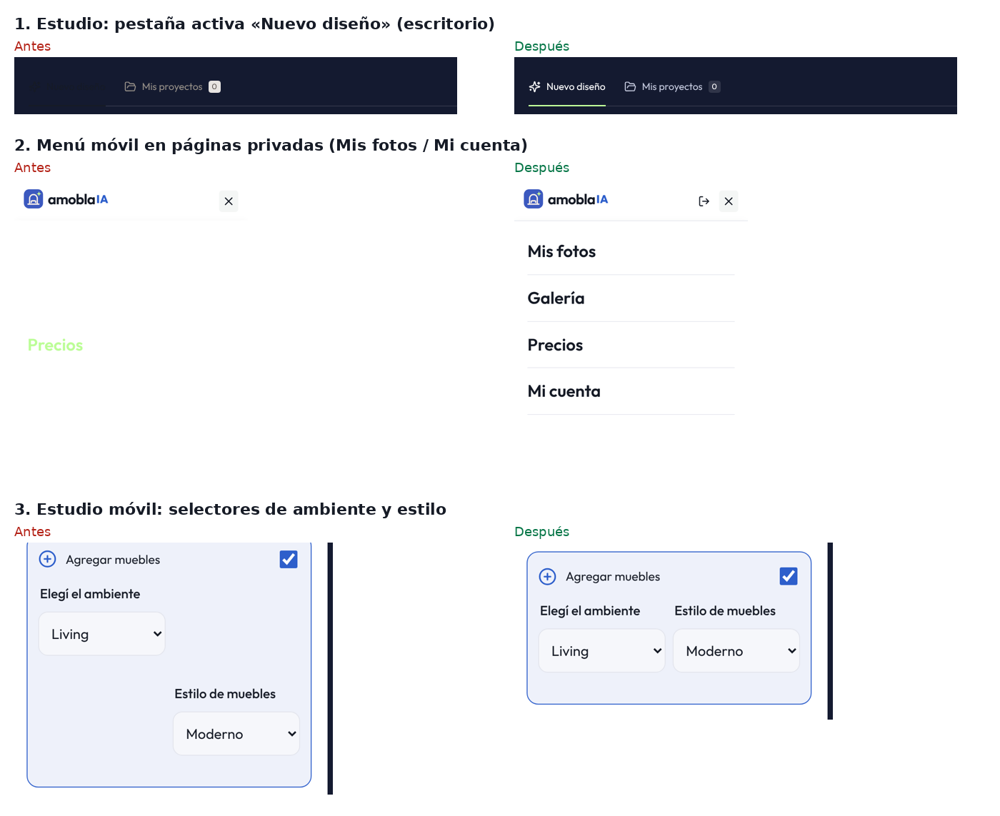

# Auditoría de diseño, UX y UI — 21 de octubre de 2026

Alcance: todas las páginas públicas, el estudio (vacío, con foto, ejemplo, resultado y comparador), menús, desplegables, FAQ, precios mensual/anual y las cabeceras privadas. Escritorio 1440 px, tablet 768/1024 px y móvil 390/360 px. Se auditó producción (https://amoblaia.vercel.app) y la versión local con los cambios.

## Método

- Script de Playwright que recorre cada página, hace scroll para cargar imágenes diferidas y mide el contraste WCAG real de cada texto visible contra el fondo que efectivamente tiene detrás (capas, transparencias y degradados), incluidos placeholders.
- Detecta también desbordes horizontales, objetivos táctiles menores de 24 px y texto menor de 12 px.
- Revisión visual de capturas completas de cada ruta y estado.
- El estudio embebido del home solo aparece con la prueba gratis activa, como en producción. Se verificó en producción, vacío y con foto cargada.
- Las páginas privadas (Mis fotos, Mi cuenta, Administración), el checkout y el recorrido guiado requieren una sesión real: se revisaron su CSS y la cabecera privada, no las pantallas con datos.

## Causa principal

`globals.css` tiene tres generaciones de estilos superpuestas (terracota/verde original, rediseño azul marino y réplica del home). Varias reglas nuevas tienen **menos especificidad** que las viejas que querían reemplazar, y muchos grises cálidos del tema anterior quedaron debajo del azul marino. De ahí salen los textos invisibles: blanco sobre blanco y oscuro sobre oscuro.

## Hallazgos y correcciones

### Críticos: texto invisible (corregidos)

| Dónde | Problema | Contraste antes → después |
| --- | --- | --- |
| Estudio, pestaña activa «Nuevo diseño» | Texto casi negro sobre azul marino: `.studio-tabs .selected` perdía contra `.studio-tabs > button.selected` | 1:1 → 17:1 |
| Menú móvil/tablet en Mis fotos, Mi cuenta y Administración | Cabecera blanca con links blancos; «Precios» en lima sobre blanco | 1:1 → 17:1 |
| Home, estudio embebido (prueba gratis) | Títulos, «Todo empieza con una foto», «Elegí el ambiente», «Estilo de muebles» y «Un toque personal» heredaban el blanco del hero; los títulos también tomaban el tamaño del hero | 1:1 → 17:1 |
| Precios, plan destacado | «por mes» gris claro sobre verde lima | 1,6:1 → 5:1 |
| Estudio, cabecera | Ruta «Estudio de diseño» y etiqueta superior grises sobre azul marino | 2,5:1 y 3,5:1 → 17:1 y 14:1 |
| Botones deshabilitados («Disponible pronto», «Generar mi diseño» sin foto) | Azul lavado con texto blanco | 2,4:1 → 5:1 |
| Herramientas pagas bloqueadas (Mejorar foto, Día a atardecer) | Texto al 45 % de opacidad | 1,7:1 → 5,1:1 |

### Contraste bajo (corregidos)

- Placeholder del newsletter del pie, presente en todas las páginas: 2,4:1 → 5,4:1. Todos los placeholders usan ahora un gris que cumple AA.
- Estudio: textos de ayuda, contador 0/500, «opcional», nota bajo el botón, consejo de arquitectura (2,8–4,2:1).
- Etiquetas superiores de las páginas internas, filtros y aviso de la galería, FAQ y 404 (4,0–4,4:1).

Se agregó el token `--subtle` (#646a7c): mínimo 4,5:1 sobre blanco, `--sand` y el verde lima. Los ~80 grises cálidos sueltos se reemplazaron por `--muted` y `--subtle` en textos. En fondos y bordes se reemplazaron por su equivalente azul-gris de igual luminancia, sin cambiar el contraste. Se conservaron los colores semánticos de error y aviso.

### Coherencia visual (corregidos)

- Los beige del tema anterior (insignia «Modo demo», avisos, fondo del área de carga y banner de prueba en Precios) pasan a la gama azul-gris de `DESIGN.md`.
- Casillas, ejemplo seleccionado e insignia del estudio usan el azul y el lima de la marca en lugar del marrón anterior.
- El punto final del titular del estudio pasa a lima, como en Precios.

### Diseño y UX (corregidos)

- **Estudio móvil:** los selectores de ambiente y estilo quedaban escalonados por una regla vieja (`fieldset:nth-of-type(2)`) que los ubicaba en otra fila. Ahora quedan lado a lado.
- **Estudio móvil:** el botón «Generar» se salía de la tarjeta 22 px por lado y tenía una línea pegada encima.
- **Estudio en tablet (701–1050 px):** la columna de ajustes medía menos de 300 px, con selectores cortados («Liv», «Mo») y el botón tapando el campo de notas. Ahora se apila como en móvil.
- **Estudio móvil:** la insignia de estado flotaba sobre la ruta; ahora queda debajo de la introducción. Herramientas de foto: dos columnas iguales, no dos tercios vacíos.
- **Home, galería:** 4 de 11 estilos (Industrial, Minimalista, Clásico, Estándar) quedaban ocultos en una tira sin barra de scroll, inaccesibles con mouse. Ahora pasan a una segunda fila.
- **Menú móvil público:** solo ofrecía «Mi cuenta». Ahora tiene «Entrar» y «Crear cuenta». En las páginas privadas se eliminó el «Mi cuenta» duplicado.
- **Cabecera 801–1100 px:** «Entrar» desaparecía sin alternativa. Ahora queda visible hasta 701 px, donde toma el control el menú.
- **Acceso con Google en móvil:** el botón de Google se dibujaba siempre con 320 px fijos (medía su contenedor centrado, de ancho 0) y la tarjeta desbordaba 8 px en 390 px y más en 360 px. Ahora toma el ancho de la tarjeta.
- Casillas de 13 → 16–18 px y etiquetas superiores móviles de 11 → 12 px.

## Verificación

- Auditoría automática final: 0 textos bajo AA en 21 rutas × 2 tamaños y 12 estados interactivos. Los únicos avisos restantes son falsos positivos: opciones de listas con scroll fuera de su caja, o elementos en el borde exacto del viewport.
- Sin desborde horizontal en 360, 390, 720, 768, 820, 900, 1024, 1100, 1280 y 1440 px.
- Ajuste del botón de Google comprobado contra el HTML de producción en 360, 390 y 1440 px.
- `npm run lint`, `npm run typecheck`, `npm test` (167 pruebas) y `npm run build` aprobados.

## Pendientes recomendados (no incluidos en este cambio)

1. **Consolidar `globals.css` (≈7.100 líneas).** Las tres capas superpuestas causaron todos los errores críticos. Conviene unificar por componente y eliminar reglas muertas (hay 36 clases sin uso, como `showcase-*`, `gallery-card*`, `room-options` y `style-options`).
2. **Texto de 11 px en el estudio:** metadatos, contador y nota del botón siguen en 11–11,5 px. Cumplen contraste, pero en móvil conviene llevarlos a 12–13 px.
3. **«Cómo funciona» en móvil:** es un carrusel horizontal sin indicador de páginas. El paso 2 se ve cortado, pero no hay puntos ni flechas.
4. **Probar con sesión real:** Mis fotos, Mi cuenta, Administración, checkout de Mercado Pago y el recorrido guiado. Se revisaron por CSS, no con datos.
5. **Resultado del estudio en escritorio:** con foto cargada, la columna de ajustes mide 220 px y los textos quedan apretados. Podría pasar a 260–280 px.
